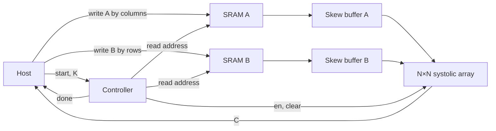

# AI accelerator with full DFT

A small matrix-multiply accelerator for neural-network inference, written in SystemVerilog, with the goal of taking it all the way through design-for-test (scan, ATPG, JTAG, memory BIST and logic BIST) and physical design.

**Status:** stage 1 of 5 (design) is complete. Stage 2 (structural DFT) is in progress: scan insertion, fault simulation and ATPG are done.

## What it does

The accelerator computes `C = A × B` for signed 8-bit matrices, the core operation of every neural-network layer. `A` is N×K, `B` is K×N, and `C` is N×N with 32-bit results. N is a parameter (tested at 2, 4 and 8); K can be anything from 1 up to the memory depth.



## How it works

**Systolic array.** An N×N grid of processing elements (PEs). Each PE multiplies two 8-bit numbers and adds the product to its own 32-bit accumulator. Values of `A` move one PE to the right every cycle and values of `B` move one PE down, so each number is read from memory once and reused by a whole row or column. The dataflow is *output-stationary*: PE(i,j) keeps `C[i][j]` until the run ends.

**Skew buffers.** For the right pairs to meet, row i of `A` must enter i cycles after row 0 (and the same for the columns of `B`). The memories deliver a whole column at once, so a skew buffer delays lane i with a chain of i registers.

**Controller.** A two-state FSM (IDLE, RUN) with a cycle counter. It reads one memory address per cycle for K cycles, then feeds zeros while the last values travel through the array.

**Memories.** The SRAMs have a synchronous read: data appears one cycle after the address. `en`, `clear` and the read-valid flag therefore pass through one flip-flop each, so they reach the array in the same cycle as the data they belong to.

A full run takes:

```
cycles = K + 2(N-1) + 1
```

## Results

Generic synthesis with Yosys (no technology library yet), for the core: array plus skew buffers.

| Array | Flip-flops | Logic cells (all) |
|---|---|---|
| 4×4 | 800 | ~12,000 |
| 8×8 | 3,392 | ~48,000 |

The flip-flop count matches a hand calculation: 48 per PE (8 + 8 + 32 bits), plus the skew registers, minus the `a_out` registers of the last column and the `b_out` registers of the last row. Those drive nothing, so synthesis removes them. For 8×8: 3072 + 448 − 128 = 3392.

## Verification

Each block has its own cocotb testbench, checked against NumPy.

| Testbench | Block | What it checks |
|---|---|---|
| `tb/` | PE | corner values (−128 × −128 and others), 1000 random accumulations, pass-through timing |
| `tb/array/` | 2×2 array | hand-wired version, random matrices back to back |
| `tb/array_n/` | N×N array | identity matrix first (easy to debug), then random matrices with K = 1, N, 3N |
| `tb/core/` | array + skew | the same, with the skew done in hardware |
| `tb/top/` | full accelerator | identity, exact cycle count, random runs, and junk on the inputs after `done` must not change the result |
| `tb/scan/` | core after scan insertion (gate level) | still multiplies correctly with `scan_en = 0`; chain integrity (random bits in, same bits out); load, capture one cycle, unload |

The testbenches were also checked against planted bugs (an 8-bit product, an always-on enable, control not delayed for the SRAM) to make sure each one fails when it should.

## Scan

`dft/` synthesizes the core to a flat gate-level netlist, then `insert_scan.py` adds scan to every flip-flop: a mux in front of D (normal data or the previous flop in the chain), and an OR on the enable so the chain can shift even when the core is frozen. The flip-flops are split into a chosen number of equal chains, and a map file records which signal sits at each chain position.

| 4×4 core | Cells | Flip-flops |
|---|---|---|
| Before scan | 12,036 | 800 |
| After scan (4 chains of 200) | 13,636 | 800 |

The extra 1,600 cells (+13%) are one mux and one OR per flip-flop.

```
cd dft
make N=4 CHAINS=4
cd ../tb/scan
make N=4 CHAINS=4
```

## Fault simulation and ATPG

Run on one PE after synthesis (715 gates, 48 flip-flops). With full scan, every flip-flop is both a controllable input and an observable output, so the PE is tested as combinational logic. The fault list is every signal stuck at 0 and stuck at 1: 781 signals, 1,562 faults.

- `fault_sim.py` injects each fault and simulates all random patterns at once (one bit of a Python integer per pattern).
- `atpg.py` takes the faults that random patterns missed, and for each one asks a SAT solver for an input pattern on which the good and the faulty circuit differ. A pattern found is a test (and is checked by simulation); no pattern is a proof that the fault is untestable.

| Random patterns | Coverage |
|---|---|
| 1 | 34.8% |
| 8 | 83.1% |
| 64 | 96.3% |
| 1,024 | 99.4% |
| 65,536 | 99.8% |

Coverage climbs fast and then flattens: the last faults need very specific values (for example a carry through the whole adder). After 1,024 random patterns, ATPG finds tests for 9 of the 10 remaining faults and proves the last one untestable:

| | |
|---|---|
| Fault coverage | 1561 / 1562 = 99.94% |
| Test coverage (untestable faults excluded) | 1561 / 1561 = 100% |

Two of the faults found by ATPG were still undetected after 65,536 random patterns.

```
cd dft
make faultsim PATTERNS=1024
make atpg PATTERNS=1024        # needs: pip install python-sat
```

Simplifications: faults are on signals only (no separate faults on fanout branches), clock and reset are not in the fault list, and the numbers above come from Yosys 0.33; a different Yosys version builds a slightly different netlist.

## Design notes

- **`clear` is shared by all PEs**, but PEs start at different cycles. This works because a PE loads `acc = a × b` on `clear`, and the controller always ends a run with zeros, so the internal wires hold zeros when the next run starts. The condition is guaranteed by the controller, not left to the user.
- **Control is aligned with data.** Any extra latency on the data path (here, one cycle of SRAM read) gets the same number of flip-flops on the control signals. A memory with a latency of L cycles needs a chain of L.
- **`en` freezes the whole core** outside a run, so the result stays stable until the host reads it, and idle registers do not toggle.

## Repository layout

```
rtl/
  pe.sv               one multiply-accumulate unit
  systolic_2x2.sv     hand-wired 2x2 array (first version)
  systolic_array.sv   NxN array, built with generate
  skew_buffer.sv      delays lane i by i cycles
  systolic_core.sv    skew buffers + array
  sram.sv             memory with synchronous read
  controller.sv       FSM, cycle counter, control alignment
  accel_top.sv        controller + memories + core
tb/                   cocotb testbenches, one folder per block
synth/core.ys         Yosys synthesis script
dft/                  scan insertion flow (synthesis, insert_scan.py, netlist)
```

## Running it

Requirements: Icarus Verilog, Yosys, Python 3 with `cocotb`, `numpy` and (for ATPG) `python-sat`.

```
cd tb/top
make N=4          # or N=2, N=8

cd ../../synth
yosys -s core.ys
```

## Roadmap

1. **Design** (done): PE, array, skew, controller, memories, synthesis.
2. **Structural DFT** (in progress): scan insertion, fault simulation and ATPG for stuck-at faults (done); next: transition faults and a JTAG TAP controller.
3. **BIST:** March C- memory BIST for the SRAMs, LFSR/MISR logic BIST for the array.
4. **FPGA demo:** run a small network, inject faults, show the BIST catching them.
5. **Physical design:** OpenLane on SkyWater 130 nm, with the area and timing cost of DFT.
